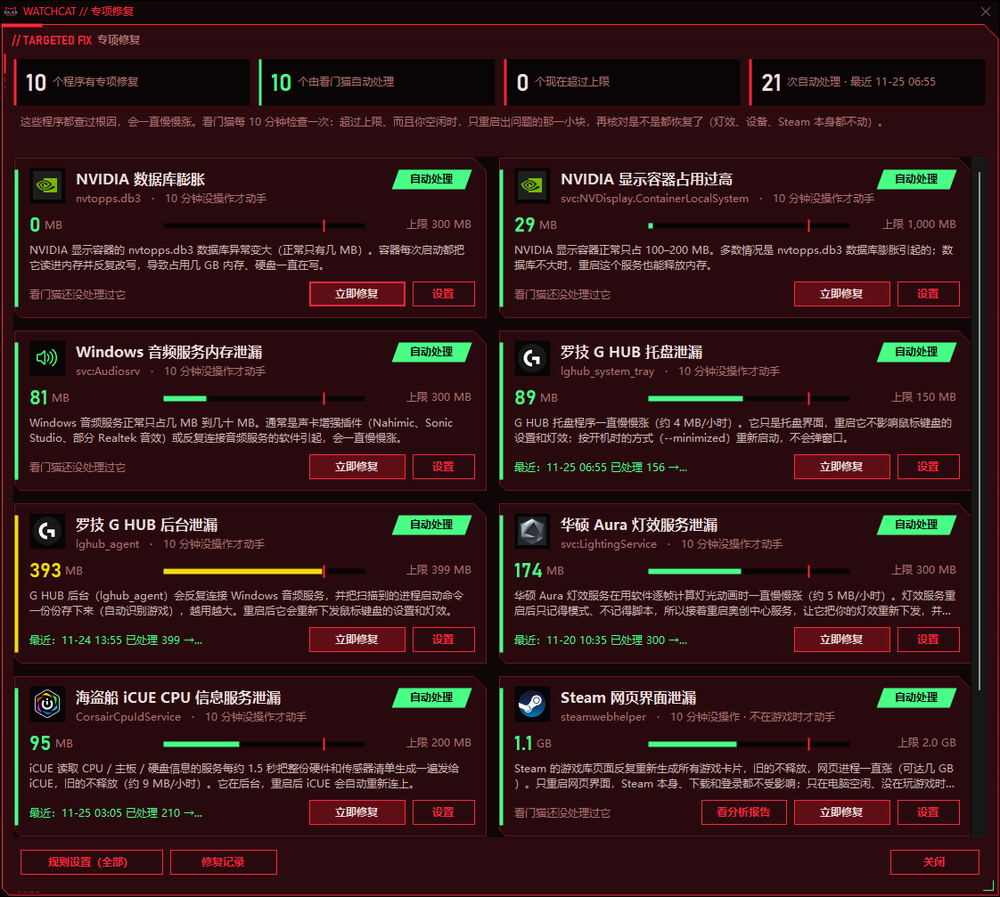
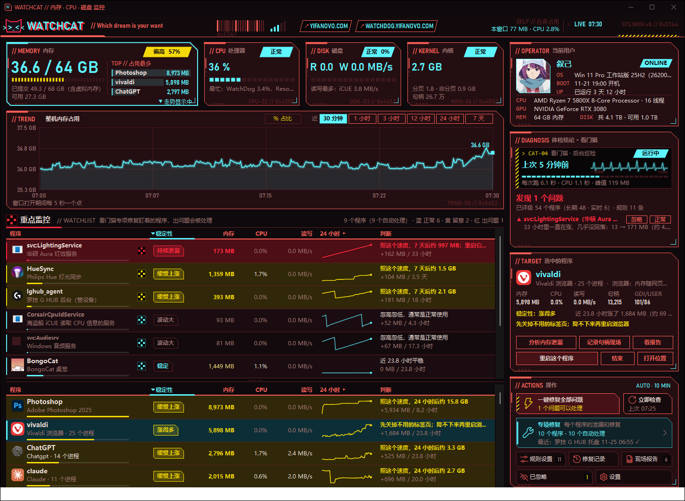
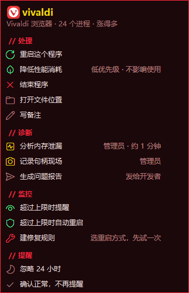
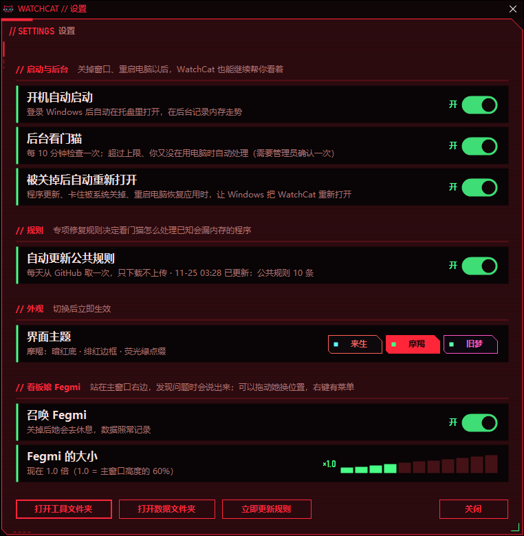
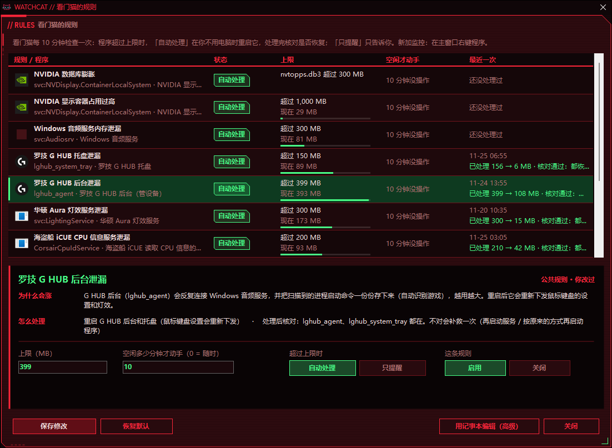

<h1 align="center">WatchCat · 看门猫</h1>

Windows 内存泄漏体检与修复 · 赛博朋克风 · 带小助手 Fegmi

## 它能做什么

- **找出谁在变坏**：不只看谁占得多，而是看谁在一直涨——每个程序都有稳定性评级（稳定 / 缓慢上涨 / 疑似泄漏 / 占用大……）和 24 小时走势。
- **驱动、句柄、图形资源泄漏也能发现**：内核内存池、句柄数、GDI / USER 对象一起盯着。
- **自动修复**：后台每 10 分钟巡检一次，超过上限、你又没在用电脑时，只重启出问题的那一部分，并核对重启后是否恢复。
- **公共规则库**：常见的漏内存程序（NVIDIA、罗技 G HUB、华硕 Aura、海盗船 iCUE、Steam……）已有专项修复规则，每天自动更新。
- **降低性能消耗**：右键任意程序，把它设成低优先级（Windows 11 的效率模式），玩游戏时让出 CPU，程序照常运行。
- **问题报告**：不知道怎么处理的程序，一键生成报告发给开发者。
- **轻量**：自身约 60 MB 内存，平时几乎不占 CPU。

## 专项修复

已知会漏内存的程序，每个都有一张卡片：现在多大、离上限还有多远、为什么会涨、最近一次处理的结果，可以立即修复或改设置。

## 小助手 Fegmi

站在主窗口右边的看门猫值班员。平时待机，打招呼时挥手，发现问题时担心地说出来，一切正常时开心。可以拖动、调大小，设置里可以让她休息。

## 三套主题

| 来生 | 摩羯 | 旧梦 |
|---|---|---|
|  |  |  |

## 更多截图

| 右键菜单 | 设置 |
|---|---|
|  |  |

---

需要 Windows 10 / 11。所有记录都只保存在本机，不上传。
详细说明（评级规则、修复原理、规则格式）见 [docs/GUIDE.md](docs/GUIDE.md)。
官网：[watchcat.yifanovo.com](https://watchcat.yifanovo.com)
